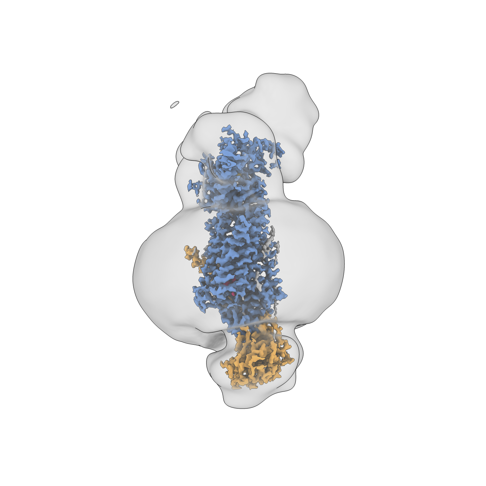

# SPA-signal-subtraction

Signal subtraction and micelle handling for single-particle cryo-EM refinement, with RELION as
the target. The repository holds two things:

- **[`docs/relion_micelle_options.md`](docs/relion_micelle_options.md)** covers the mechanisms
  RELION 5 already offers for a detergent micelle or nanodisc, checked against the source:
  - particle subtraction;
  - `--solvent_mask2`;
  - the GUI-hidden `--lowpass_mask`;
  - Blush;
  - multi-body refinement;
  - the external-reconstruct hook.

  It also summarises what the literature does and does not show, and gives a test plan.
- **[`examples/emd-32299`](examples/emd-32299)** is a worked example on a public membrane-protein
  map, the gastric proton pump in detergent:
  - visualising the micelle (low-pass, not threshold);
  - a measured belt profile;
  - a model-free builder for **protein / micelle / envelope masks**, with protein defined by local
    half-map correlation and validated against the fitted model.



## Quick start

```bash
cd examples/emd-32299
bash fetch.sh                        # public EMDB/PDB inputs
python3 -I viz/micelle_masks.py      # masks for RELION
```

To build masks for your own refinement, pass its unfiltered half maps:

```bash
python3 -I examples/emd-32299/viz/micelle_masks.py \
    --half1 run_half1_class001_unfil.mrc --half2 run_half2_class001_unfil.mrc \
    --model '' --out my_masks
```

## Status

The masks are validated on one map. The RELION options and the test plan have **not** yet been
run on particle data.

## Licence

Apache-2.0, © 2026 Diamond Light Source. See `LICENSE` and `NOTICE`. The example's input data is
public and is downloaded at run time, not redistributed.
